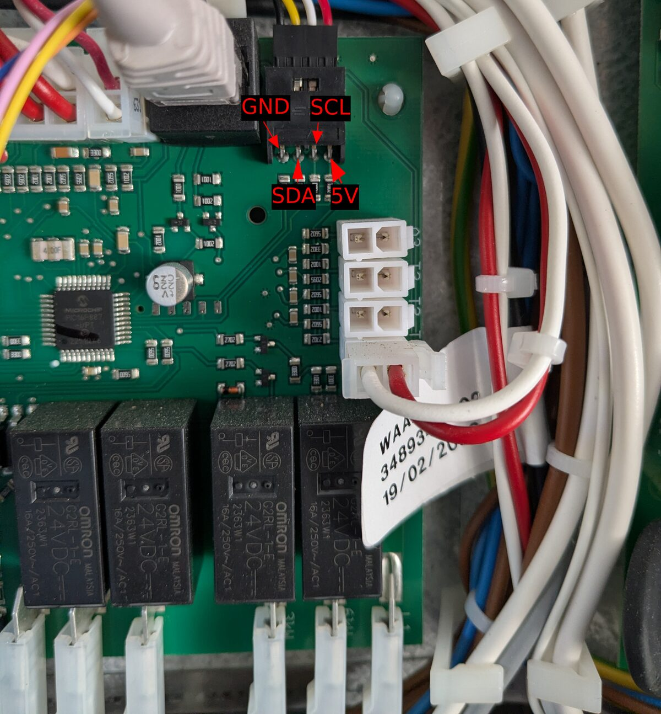

# ESPHome component for Thermia / Danfoss heat pumps (EXT port)

[](https://buymeacoffee.com/mdepa91)

Read **and write** Thermia / Danfoss ground-source heat pump parameters from Home Assistant with a plain
**ESP8266** (Wemos D1 mini) or **ESP32** (any variant) wired to the pump's **EXT** connector. No ThermIQ box, no Arduino bridge.

- 40+ ready-made entities: temperatures, compressor / pump / heater status, alarms, run-time counters.
- Writable settings as `number` / `select` entities: room temperature setpoint, operating mode, heating curve,
  hot water thresholds, …
- Generic `registers:` (read) and `set_registers:` (write) for anything else in the register map.
- Optional **smart grid / EVU** control: a `select` that drives the pump's SG1/SG2 inputs (terminals 307/308 and
  309/310) through PhotoMOS relays – EVU block, reduction, comfort, boost. See [Smart grid / EVU](#smart-grid--evu).
- Software I2C **slave** on ESP8266 and ESP32, running entirely in IRAM, with host-side unit tests (203 checks).
- Pairs with [esphome-thermia-room](https://github.com/mdepa91/esphome-thermia-room), which emulates the room sensor (terminals 303/304) so the
  pump regulates on a real room temperature and a setpoint from Home Assistant. Both run on one ESP32.
- Visualised by [thermia-heatpump-card](https://github.com/mdepa91/ha-thermia-heatpump-card), a Lovelace card that draws the pump with live
  temperatures and a spinning compressor and pumps. The component publishes a *Thermia card map* entity, so the card
  fills in its entities after you pick the ESPHome device.

> **Tested on:** Thermia Duo 400V 10 kW – Wemos D1 mini (ESP8266, ESPHome 2026.9.0) and ESP32-S3
> (ESPHome 2026.9.1, together with [esphome-thermia-room](https://github.com/mdepa91/esphome-thermia-room)).
> Other Thermia / Danfoss models using the same EXT protocol (the one ThermIQ talks to) will most likely work,
> but register meanings may differ – compare with your pump's display before trusting a value.

> ⚠️ **Writing to your heat pump is at your own risk.** Only change settings you understand, in small steps,
> with the pump's display at hand. See [Writing settings](#writing-settings).

## Hardware

```
Thermia EXT (5 V)      bi-directional level shifter      Wemos D1 mini (3.3 V)
  SDA  ────────────────  HV ─── LV  ─────────────────────  D2 (GPIO4)   = sda_pin
  SCL  ────────────────  HV ─── LV  ─────────────────────  D1 (GPIO5)   = scl_pin
  GND  ────────────────  GND ── GND ─────────────────────  GND
```

- EXT is a 4-pin connector: GND, SDA, SCL, 5 V – see the [photo below](#ext-connector). Verify the pin order on
  your own unit.
- The bus is **5 V**; use a bi-directional level shifter (BSS138 type). The pump has its own pull-ups.
- Power the ESP from its own USB supply; connect only GND + SDA + SCL to EXT. Wire it with the pump switched off.
- ESP8266: D1/D2 are recommended: they are not boot-strapping pins. GPIO0–15 are accepted.
- ESP32: GPIO0–31 are accepted; avoid boot-strapping pins (GPIO0/2/5/12/15 on the classic ESP32) and the
  flash pins. GPIO21/22 work well on an ESP32 DevKit. The ESP32 is 3.3 V too – keep the level shifter.
  Minimal config: [`example-esp32.yaml`](example-esp32.yaml).

### EXT connector

On the controller board of a Thermia Duo (PIC16F887 board) the EXT header is at the top edge, right next to the
Ethernet (RJ45) socket used by the display.
Pin order, left to right: **GND, SDA, SCL, 5 V**. The 5 V pin is not needed – power the ESP from its own supply.



## Installation

```yaml
external_components:
  - source: github://mdepa91/esphome-thermia
    components: [thermia]

thermia:
  sda_pin: D2
  scl_pin: D1
  update_interval: 10s
  link:
    name: "EXT link"
  temp_outdoor:
    name: "Outdoor temperature"
  temp_supply:
    name: "Supply (T1)"
  compressor:
    name: "Compressor"
  alarm:
    name: "Alarm"
  setting_indoor_temp:
    name: "Room temperature setpoint"
  setting_main_mode:
    name: "Operating mode"
```

A complete configuration with every entity is in [`example.yaml`](example.yaml)
(secrets template: [`secrets.example.yaml`](secrets.example.yaml)).

Do **not** add an `i2c:` block – the ESPHome I2C component can only be a master, and here the pump is the master.

## Configuration variables

| Option | Default | Description |
|---|---|---|
| `sda_pin`, `scl_pin` | **required** | GPIO pins wired to EXT via the level shifter: GPIO0–15 on ESP8266, GPIO0–31 on ESP32. |
| `update_interval` | `10s` | How often entity states are published. |
| `stale_timeout` | `120s` | A value older than this is published as unavailable. |
| `request_tries` | `50` | How many pump pings (~13 ms apart) we keep asking for one register before moving on. Some registers (e.g. `temp_outdoor`, r00) are answered only after a longer wait – with `3` they never arrived. |
| `debug_frames` | `false` | Log every bus frame. Useful for first start-up only; it costs CPU and UART time. |
| `sniff` | `false` | Hardware diagnostics: record raw SDA/SCL waveforms. **Disables the protocol.** See [Diagnostics](#diagnostics). |
| `selftest` | `false` | Hardware diagnostics: probe the SDA line at boot and log level changes. |
| `link` | – | Binary sensor (connectivity): on while the pump is talking to us. |
| `card_map` | name: *Thermia card map* | Diagnostic select that lists `<config key>=<entity name>` for every configured entity, so [thermia-heatpump-card](https://github.com/mdepa91/ha-thermia-heatpump-card) can pick the entities by itself once you choose this device. Read-only: whatever is selected, it goes back to the marker option. Accepts the usual select options; `internal: true` hides it from Home Assistant. |
| `registers` | – | List of extra read-only sensors: `register` (0x00–0x7F), `scale` (default 1), `signed` (default true) + any sensor option. |
| `set_registers` | – | List of extra writable numbers: `register`, **`min_value`, `max_value` (required)**, `step`, `scale`, `signed` + any number option. |

### Sensors

All values are whole numbers as reported by the pump (temperatures in °C, signed 16-bit).

| Key | Register | Unit |
|---|---|---|
| `temp_outdoor` | r00 | °C |
| `temp_indoor` | r01 | °C (virtual indoor temperature) |
| `temp_indoor_target` | r03 | °C |
| `temp_supply` | r05 | °C (supply line, T1) |
| `temp_return` | r06 | °C (return line, T2) |
| `temp_hotwater` | r07 | °C (hot water tank, T3) |
| `temp_brine_out` / `temp_brine_in` | r08 / r09 | °C |
| `temp_cooling` | r0A | °C |
| `temp_supply_shunt` | r0B | °C |
| `temp_supply_target` | r0E | °C |
| `temp_supply_shunt_target` | r0F | °C |
| `temp_hot_gas` | r17 | °C (compressor discharge) |
| `temp_hotwater_supply` | r18 | °C |
| `current` | r0C | A |
| `integral` | r19 | °C·min (degree-minutes) |
| `supply_pump_speed` / `brine_pump_speed` | r1E / r1F | % |
| `sw_version` | r1D | diagnostic |
| `runtime_compressor` | r68 | h |
| `runtime_aux_3kw` | r6A | h |
| `runtime_hotwater` | r6C | h |
| `runtime_aux_6kw` | r72 | h |

### Binary sensors

| Key | Register & bit |
|---|---|
| `brine_pump`, `compressor`, `supply_pump`, `hotwater_production`, `aux2_heating`, `aux1_heating` | r10: `0x01`, `0x02`, `0x04`, `0x08`, `0x10`, `0x80` |
| `aux_3kw`, `aux_6kw` | r0D: `0x01`, `0x02` |
| `alarm` | r11: `0x40` |
| `alarm_high_pressure`, `alarm_low_pressure`, `alarm_motor_breaker`, `alarm_brine_flow`, `alarm_brine_temperature` | r13: `0x01`…`0x10` |
| `alarm_outdoor_sensor`, `alarm_supply_sensor`, `alarm_return_sensor`, `alarm_hotwater_sensor`, `alarm_indoor_sensor`, `alarm_phase_order`, `alarm_overheating` | r14: `0x01`…`0x40` |

### Writable settings

Each of these accepts the usual `number` options; `min_value` / `max_value` can be narrowed in YAML.

| Key | Register | Type | Default range | Verified on a real pump |
|---|---|---|---|---|
| `setting_indoor_temp` | r32 | number, °C | 10–30 | ✅ tracked changes made on the pump's own display |
| `setting_main_mode` | r33 | select | Off / Auto / Heatpump only / Heater only / Hot water only | ✅ |
| `setting_curve_slope` | r34 | number | 22–56 | range from the pump menu |
| `setting_curve_min` / `setting_curve_max` | r35 / r36 | number, °C | 0–200 | ❌ |
| `setting_curve_offset_p5` / `_0` / `_n5` | r37 / r38 / r39 | number, °C | −5–5 | ❌ |
| `setting_room_factor` | r3C | number | 0–4 (room temperature influence, needs a room sensor – physical or [esphome-thermia-room](https://github.com/mdepa91/esphome-thermia-room)); 0 = room sensor off, the pump regulates to r32 (pump manual) | ❌ |
| `setting_heating_stop_temp` | r3A | number, °C | 0–200 | ❌ |
| `setting_hotwater_start_temp` / `setting_hotwater_stop_temp` | r44 / r54 | number, °C | 0–100 | ❌ |
| `setting_max_electric_steps` | r51 | number | 0–3 | ❌ |
| `setting_max_current` | r52 | number, A | 0–100 | ❌ |

❌ = register meaning taken from the ThermIQ map, not yet confirmed on real hardware. Wide default ranges are raw
register limits – **set sensible `min_value` / `max_value` for your installation** (see `example.yaml`).

## Writing settings

When the pump reads a byte from us, instead of a register number we may answer `[register | 0x80, lo, hi]` –
"write this value to that register". There is **no protocol-level acknowledgement**: we only know the pump
received the three bytes. That is why every writable entity also **polls its own register**: the state shown in
Home Assistant is what the pump actually reports, so if the pump ignores or clamps a value, the entity corrects
itself on the next read. Until the pump reports the register again after a write, the entity keeps the value you
set rather than falling back to the reading from before the write. The pump may answer some registers (e.g. r32)
only every few minutes. Such a register is marked with `~` in the `regs:` debug dump.

Not everything is writable: writing r01 (indoor temperature) to emulate a room sensor is **ignored** by the pump.
The physical "Room sensor" port is not a plain resistive input either (it carries ~27 V DC and a digital protocol).
To give the pump a real room temperature and setpoint, use [esphome-thermia-room](https://github.com/mdepa91/esphome-thermia-room): it emulates the
room sensor on that port, and this component then shows the result in `temp_indoor` / `temp_indoor_target`.

Factory reset (r59) and counter reset (r5A) are deliberately not exposed as named entities.

## Smart grid / EVU

The pump has two digital inputs for an energy supplier (EVU) or smart grid signal: **SG1 = terminals 307/308**
(labelled *EVU/Smart grid 1*) and **SG2 = terminals 309/310** (*Smart grid 2*). They need no activation in the
pump's menu. These inputs are separate from the EXT port, so the ESP drives them with its own GPIOs through
**PhotoMOS** (solid-state, optically isolated) relays. From the Thermia Legend installation guide:

| SG1 (307/308) | SG2 (309/310) | Mode | Select option |
|---|---|---|---|
| open | open | normal operation | `Normal` |
| 10 kΩ | open | reduction: room target lowered (adjustable on the pump, default 1), start temperature 2 °C lower, hot water stops at 50 °C | `Reduction` |
| short | open | **EVU block**: compressor and aux heater off – risk of freezing if held too long. The display shows *EVU STOP*; after it ends, the aux heater waits *OPOZN. PO EVU* (default 30 min) | `EVU block` |
| open | short | comfort: hot water start +4 K (max 48 °C), room target +SG+ | `Comfort` |
| short | short | boost: hot water start +6 K, one hot water top-up (may use the aux heater), room target +SG+ +1 | `Boost` |

```yaml
thermia:
  # ...
  smart_grid:
    name: "Smart grid mode"
    sg1_pin: GPIO25       # required: shorts 307/308
    sg1_10k_pin: GPIO26   # optional: 10 kΩ across 307/308
    sg2_pin: GPIO27       # optional: shorts 309/310
```

| Key | Required | Contact | Enables |
|---|---|---|---|
| `sg1_pin` | yes | short across 307/308 | `EVU block` (and `Boost` with `sg2_pin`) |
| `sg1_10k_pin` | no | 10 kΩ resistor in series, across 307/308 | `Reduction` |
| `sg2_pin` | no | short across 309/310 | `Comfort`, `Boost` |

Options whose pin is not configured are not offered in the select. Each pin accepts the usual ESPHome pin options,
including `inverted: true` (see below). Other `select` options (`icon`, `internal`, …) work too.

Behaviour:

- At boot every output is off (all contacts open = `Normal`). The mode is **not** restored after a restart and there
  are no built-in time limits – control it from a Home Assistant automation.
- When switching, new contacts close before old ones open. `Reduction` ↔ `EVU block` therefore passes through
  "10 kΩ parallel with a short" (= still a short), never through "open", so the pump never sees a brief `Normal`.
- The pump reports nothing about these inputs over EXT, so the select shows what the ESP set, not what the pump
  applied. Check the pump's display (*EVU STOP*) the first time.

### Wiring

Per channel: the PhotoMOS LED is driven by an ESP GPIO, its output contact goes to the pump terminals.

```
ESP GPIO ──[R]──►|── GND        PhotoMOS LED (anode on GPIO, cathode on ESP GND)
                 ┊ optical isolation
307 ──────────── contact ──────────── 308      sg1_pin
307 ──[10 kΩ]─── contact ──────────── 308      sg1_10k_pin
309 ──────────── contact ──────────── 310      sg2_pin
```

This is the same circuit as with two/three mechanical relays (NO contacts), just solid-state.

- **PhotoMOS:** a normally-open (form A) type with AC/DC output, so polarity on 307–310 does not matter, e.g.
  AQY212, TLP222A, G3VM-61A1, CPC1017N. Look for on-resistance of a few ohms or less and off-leakage below 1 µA:
  the pump tells "short", "10 kΩ" and "open" apart, so the contact must look like all three.
- **LED resistor:** `R = (3.3 V − V_F) / I_F`. With a typical V_F ≈ 1.2 V and I_F ≈ 5 mA, R ≈ 390 Ω (check the
  relay's minimum trigger current; stay well below the GPIO's limit, ~12 mA on ESP8266).
- **Before building a PCB, measure the open-circuit voltage and the short-circuit current on 307/308 and 309/310**
  and check them against the relay's ratings. They are low-voltage inputs, but 230 V terminals are on the same
  terminal strip – disconnect the pump's power before wiring.
- **`inverted: true`:** use it if your board drives the relay LED active-low (LED from 3.3 V to the GPIO) or through
  an inverting driver stage. Before ESPHome sets the pin up, the GPIO floats – make sure a floating pin leaves the
  relay **off** (with the circuit above it does; with an inverting driver add a pull resistor). Each pin is set
  separately, with the full ESPHome pin syntax:

  ```yaml
  smart_grid:
    name: "Smart grid mode"
    sg1_pin:
      number: GPIO25
      inverted: true    # contact closed = GPIO low
    sg1_10k_pin: GPIO26
    sg2_pin: GPIO27
  ```

### Pins

Use pins that are **not boot-strapping pins** and float (high impedance) during boot, so no relay pulses while the
ESP starts. Never reuse `sda_pin` / `scl_pin`.

| Board | Recommended | Avoid |
|---|---|---|
| ESP8266 (D1 mini) | **D5 (GPIO14), D6 (GPIO12), D7 (GPIO13)** | D3/GPIO0, D4/GPIO2, D8/GPIO15 (boot strapping), D0/GPIO16 (high at boot), TX/RX (toggle at boot) |
| ESP32 (classic) | **GPIO25, GPIO26, GPIO27**; also GPIO32, GPIO33, GPIO4 | GPIO0, 2, 5, 12, 15 (strapping), 6–11 (flash), 34–39 (input only), 1/3 (UART), 16/17 on WROVER (PSRAM) |
| ESP32-S3 | **GPIO4–GPIO7, GPIO15–GPIO18** | GPIO0, 3, 45, 46 (strapping), 19/20 (USB), 26–32 (flash), 33–37 on octal-PSRAM modules, 43/44 (UART) |
| ESP32-C3 | **GPIO4, GPIO5, GPIO10** | GPIO2, 8, 9 (strapping), 12–17 (flash), 18/19 (USB), 20/21 (UART) |

## How it works

The EXT port is an I2C bus where **the heat pump is the master** (~20 kHz clock) and the accessory is a slave
at 7-bit address **0x2E**. The ESP8266 has no hardware I2C slave, so this component implements one in software
(the ESP32 runs the same engine, see [ESP8266 vs ESP32](#esp8266-vs-esp32)):

1. A GPIO interrupt on the falling edge of SDA (START) enters `on_sda_fall()`, which then polls both lines with a
   cycle counter until STOP. Everything on that path lives in IRAM.
2. The pump periodically writes a **ping** (`0xFE`, `0xFD` after its own boot).
3. The pump then **reads one byte** from us: `0xFF` = "nothing", `0x00`–`0x7F` = "send me register N",
   `[reg|0x80, lo, hi]` = "write this value".
4. If we asked for a register, the pump writes back a **data frame** `[reg, lo, hi]` (little-endian int16).

Example of reading r06 (return temperature, 24 °C):

```
pump → us   S 5C FE P        ping
pump ← us   S 5D [06] P      we ask for r06
pump → us   S 5C 06 18 00 P  r06 = 0x0018 = 24 °C
```

Only registers used in your YAML are polled, one per ping, round-robin; a pending write has priority over reads.
Safety nets: per-edge (1.5 ms) and per-transaction (8 ms) timeouts, a circuit breaker after 50 consecutive failed
transactions, a plausibility window for temperatures (−60…200 °C), and a **bus gate** – the interrupt is attached
only after WiFi has been connected for 5 s and detached immediately when it drops, so bus traffic never starves
the WiFi association on the single ESP8266 core.

### ESP8266 vs ESP32

The protocol engine (`thermia_slave.h`) is shared; only `thermia_hw.h` differs, each backend using the fastest
access its chip offers:

| | ESP8266 | ESP32 (all variants) |
|---|---|---|
| Sampling both lines | one read of `GPI` (GPIO0–15) | one read of `GPIO_IN` (GPIO0–31) |
| Driving SDA | output-enable toggle with latch at 0 (`GPES`/`GPEC`) | hardware open-drain pad, latch `W1TC`/`W1TS` |
| Time base | `ccount` register | `esp_cpu_get_cycle_count()` (Xtensa and RISC-V) |
| Where the ISR busy-polls | the only core, shared with WiFi | core 1 (ESPHome loop), WiFi on core 0 – single-core C3/C6/S2 behave like the ESP8266 |

The ESP32's hardware I2C slave is deliberately not used: the byte we return on the pump's read depends on the ping
received just before it and would have to be in the peripheral's TX FIFO already; the sniffer and self-test also
need raw pin access. The bus gate is kept on ESP32 as well – harmless on dual-core, needed on single-core variants.

| File | Role |
|---|---|
| `thermia_slave.h`, `thermia_slave.cpp` | I2C slave engine (ISR bit-bang), protocol, sniffer, SDA probe – no ESPHome dependencies besides `IRAM_ATTR` |
| `thermia_hw.h` | Per-platform GPIO/timer access (ESP8266, ESP32); replaced by a simulator in host tests |
| `thermia_bus_gate.h` | Decides when the bus may be touched (network-stability gate) |
| `thermia.h`, `thermia.cpp` | ESPHome component: entities, publishing, logging, diagnostics |
| `thermia_number.h`, `thermia_select.h` | Writable `number` / `select` entities |
| `__init__.py` | YAML schema, driven by the register tables |

## Diagnostics

With `debug_frames: true` a healthy start-up looks like:

```
[thermia] pump -> us : FE            <- ping (our ACK works)
[thermia] us -> pump : 00            <- we ask for r00
[thermia] pump -> us : 00 03 00      <- r00 = 3
[thermia] link=up pings=57 data=57 reads=57 ok=114 err=0 foreign=.. max_isr=480us
[thermia] regs: r00=0003 r05=0018 r06=0016 ...
```

| Symptom | Meaning |
|---|---|
| `pings=0`, `isr=0` | Lines not connected (wiring, level shifter, ground) |
| `isr` grows, `pings=0`, `err`/`foreign` grow | SDA and SCL swapped, or SDA not reaching the ESP |
| `pings` grows, `data=0` | Pump pings but doesn't send registers – check the frame log |
| `err` grows together with `pings` | Interrupt too slow for the pump's clock |
| `unanswered` grows | The pump doesn't answer some register (normal for some, e.g. r10 while the compressor is idle) |
| `foreign` grows | Expected: the pump also polls addresses 0x32 and 0x37 |

**Hardware debugging** – `sniff: true` records both lines once a second (and disables the protocol). Decode with:

```sh
esphome logs thermia.yaml > logs.txt
python3 tools/decode_sniff.py logs.txt
```

`selftest: true` briefly pulls SDA low three times at boot, logs whether the line follows, then logs every SDA level
change. It never touches SCL.

Sporadic exceptions/resets: see [docs/crash-analysis.md](docs/crash-analysis.md) for what was ruled out, what was
fixed and what to collect.

## Tests

The slave engine is tested on the host against a simulated I2C master (ping → read → data frame, repeated START,
foreign addresses, stuck bus, never-ending frames, late interrupts, writes, bus gate, sniffer):

```sh
g++ -std=c++17 -DTHERMIA_HOST_TEST -I test -I components/thermia test/test_slave.cpp components/thermia/thermia_slave.cpp -o test/test_slave && test/test_slave
```

The smart grid mode → contact mapping has its own test:

```sh
g++ -std=c++17 -I components/thermia test/test_smart_grid.cpp -o test/test_smart_grid && test/test_smart_grid
```

CI runs these tests and compiles `example.yaml` (ESP8266) and `example-esp32.yaml` (ESP32, ESP32-C3) with ESPHome
on every push.

## Limitations

- ESP8266 and ESP32 only. On ESP32 `sda_pin` / `scl_pin` must be GPIO0–31, and `inverted:` is not supported on
  them (it is on the smart grid pins).
- Smart grid / EVU is compile-tested only, not yet verified on a real pump.
- Verified on real hardware with an ESP8266 (Wemos D1 mini) and an ESP32-S3; other ESP32 variants are compile-tested.
- Temperatures have 1 °C resolution – that's what the pump reports. Indoor temperature and indoor target are the
  exception: the pump reports their tenths separately (r02/r04), so they have 0.1 °C.
- Register meanings come from the ThermIQ map; not all are confirmed on every model.

## Credits

- [rainisto/arduino_i2c_orja](https://github.com/rainisto/arduino_i2c_orja) – Arduino slave for the same port
  (GPL-3.0); used as a protocol reference only, no code was copied.
- [Danfoss-lämpöpumpun salaisuudet](https://omakotikotitalomme.blogspot.com/2015/03/danfoss-lampopumpun-salaisuudet.html)
  – the original reverse-engineering blog post (pinout, address, ping, frame format).
- [ThermIQ/thermiq_mqtt-ha](https://github.com/ThermIQ/thermiq_mqtt-ha) – register map and mode labels.
- [esphome-thermia-room](https://github.com/mdepa91/esphome-thermia-room) – companion component: room sensor emulation on terminals 303/304.
- Repository layout inspired by [thegroove/esphome-custom-component-examples](https://github.com/thegroove/esphome-custom-component-examples).

Thermia and Danfoss are trademarks of their respective owners; this project is not affiliated with them.

## License

[MIT](LICENSE)
